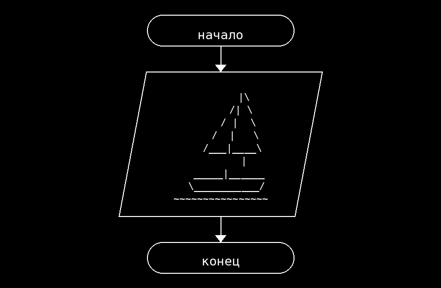

**Условие**
Написать программу, которая выводит на экран рисунок кораблика.

**Блок схема**

**Контрольный пример**
Ввод: нет
Вывод:
        |\
       /| \
      / |  \
     /  |   \
    /___|____\
        |
   _____|______
  \___________/
~~~~~~~~~~~~~~~~
